# CapitalSync - Personal Finance Companion


## 📌 Project Overview

**CapitalSync** is a professional-grade, offline-first personal finance management application built for Android. It empowers users to take control of their finances through meticulous tracking, goal setting, and data-driven insights. Designed with a focus on both aesthetic elegance and robust security, CapitalSync ensures that your sensitive financial data remains private and easily accessible.

The project follows modern Android development standards, utilizing a clean **MVVM architecture** with **Jetpack Compose** for a reactive and fluid user experience.

---

## 📱 Screenshots

<div align="center">
  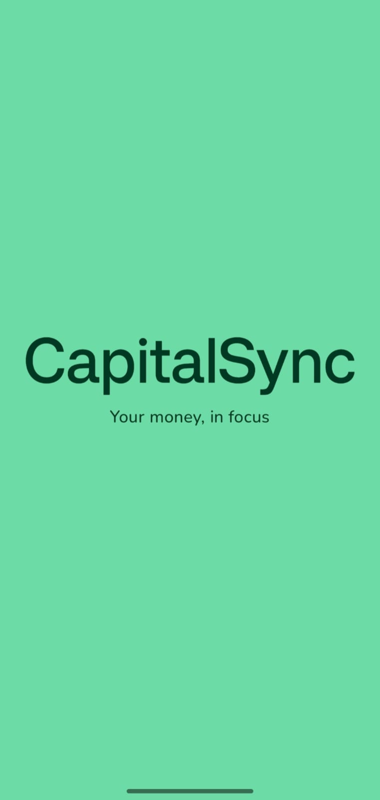
  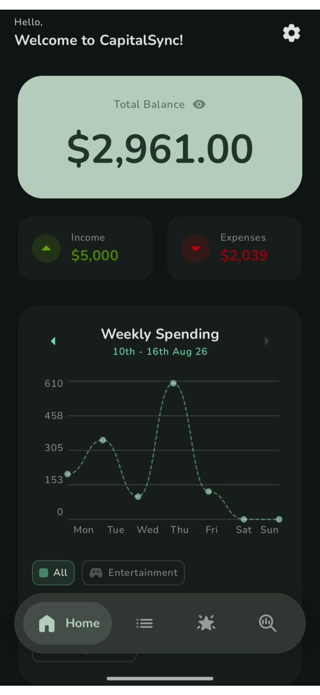
  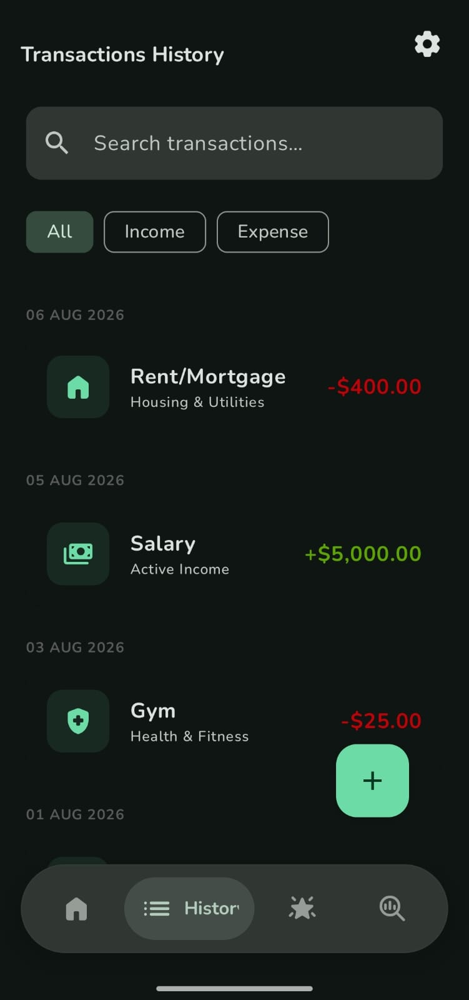
  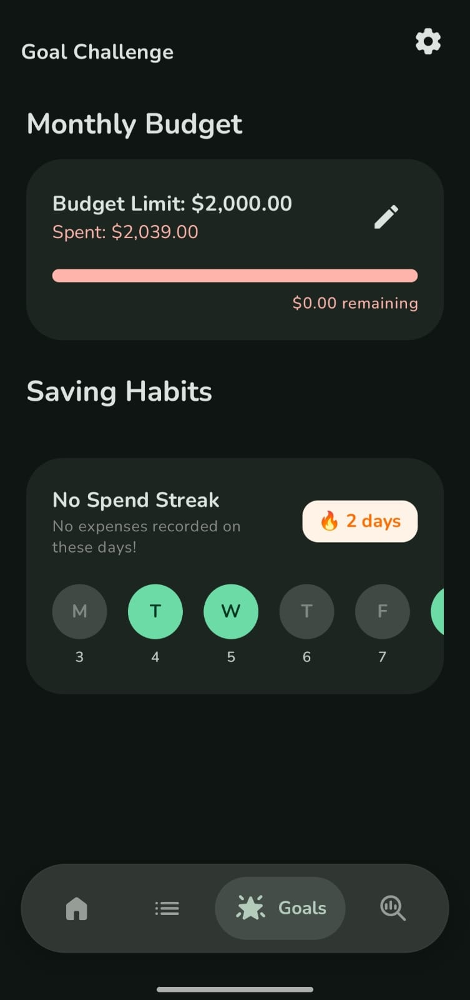
  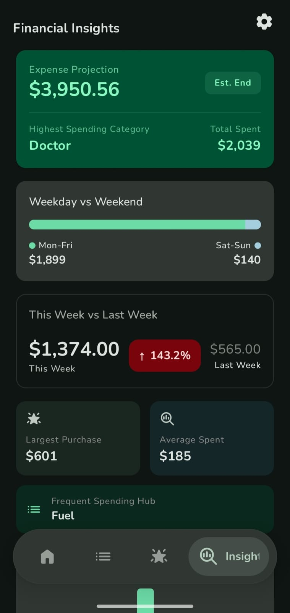
  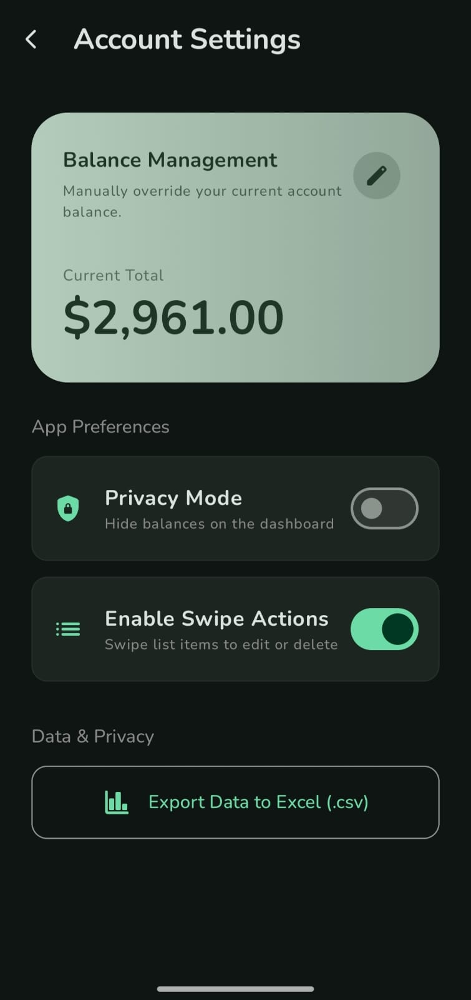
  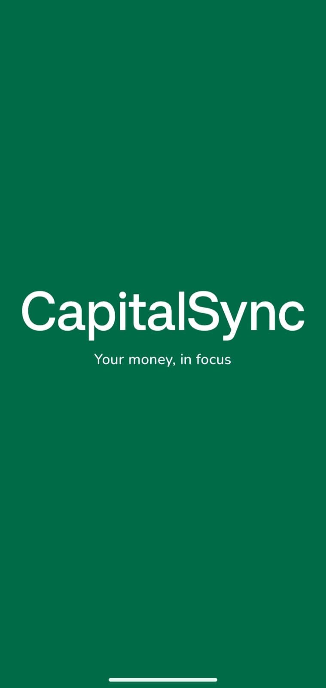
  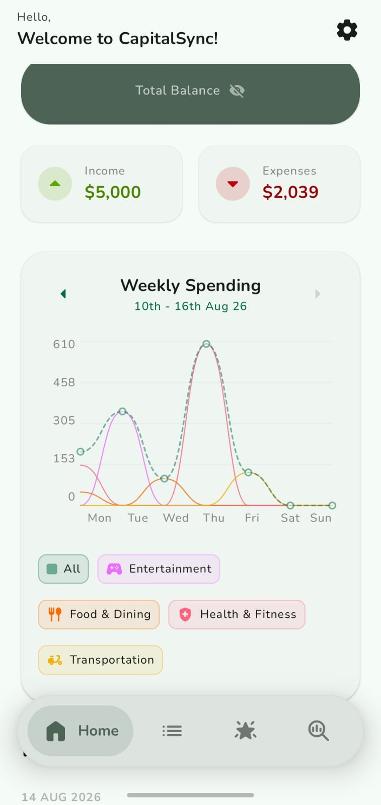
  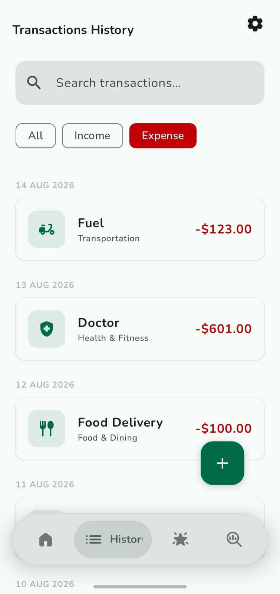
  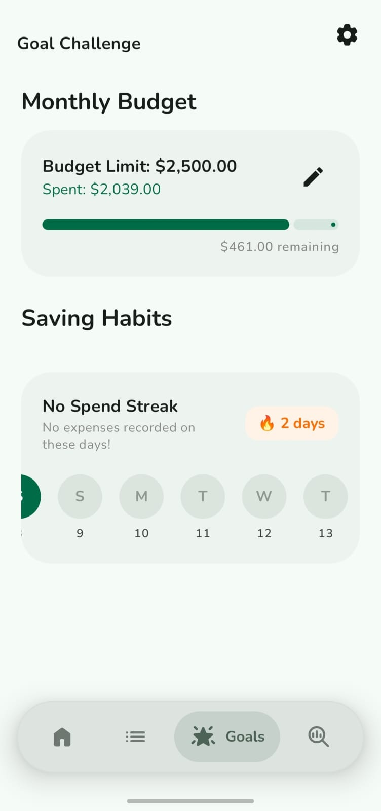
  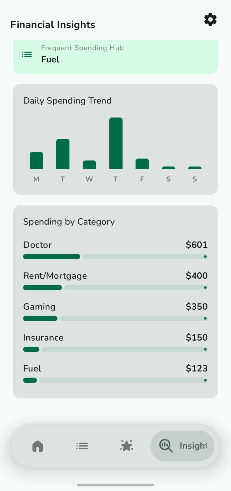
  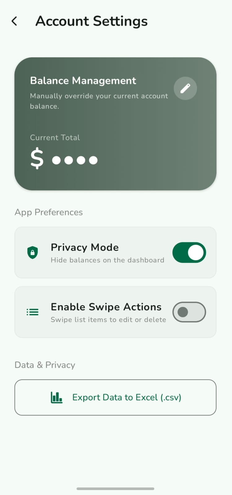
</div>

---

## 🚀 Setup Instructions

Follow these steps to get the project running on your local machine:

### Prerequisites
- **Android Studio:** Jellyfish | 2023.3.1 Patch 1 or newer (Recommended: Ladybug).
- **JDK:** Version 17 or higher.
- **Android SDK:** Compile SDK 36, Target SDK 36, Min SDK 24.

### Getting Started
1. **Clone the repository:**
   ```bash
   git clone https://github.com/Nishantptl/CapitalSync
   ```
2. **Open the project:**
   Launch Android Studio and select `Open` -> navigate to the cloned `CapitalSync` directory.
3. **Sync Gradle:**
   Allow Android Studio to download dependencies and sync the Gradle scripts.
4. **Build and Run:**
   - Select the `app` configuration.
   - Choose an emulator or a physical device (Android 7.0+).
   - Press the **Run** button (Shift + F10).

---

## ✨ Features

### 📅 Dashboard & Overview
- **Metric Hub:** Real-time visibility into current balance, monthly income, and daily expenditure.
- **Quick Actions:** Seamlessly navigate to add transactions or view goals.

### 💰 Transaction Management
- **Detailed Logging:** Track income and expenses with customizable categories and notes.
- **Transaction History:** A clean, searchable list of all past financial activities.
- **Smart Filtering:** Filter transactions by type (income/expense) to analyze specific cash flows.
- **Data Export:** Export your transaction data locally to a CSV file.

### 🎯 Goal Tracking
- **Goal Setting:** Define specific financial targets (e.g., "New Laptop", "Emergency Fund").
- **Progress Monitoring:** Visualize how close you are to reaching your savings goals with interactive progress indicators.

### 📊 Financial Insights
- **Advanced Analytics:** Gain deep insights into spending habits with category-wise breakdowns.
- **Projections:** View monthly comparisons and future projections to plan your finances better.
- **Empty State States:** Intuitive UI guidance when no data is available.

### 🛡️ Security & Privacy
- **Encrypted Storage:** All local data is stored in a **Room** database secured with **SQLCipher** (256-bit AES encryption).
- **Offline First:** No data ever leaves your device, ensuring total privacy.
- **Secure Onboarding:** A dedicated flow for first-time setup and data initialization.

---

## 📝 Assumptions

- **Offline Only:** The application does not currently support cloud sync or multi-device synchronization.
- **Local Authentication:** Security is prioritized at the data layer (database encryption). It is assumed the device handles primary biometric/passcode authentication.
- **Single Currency:** The current implementation assumes a single primary currency environment (standardized to device locale).
- **Onboarding:** Completion of the onboarding flow is required for the application to function correctly as it initializes core database structures.

---

## 🏗 Architecture & Tech Stack

The application's architecture is built on the pillars of **SOLID** principles and modern Android Jetpack libraries.

| Layer              | Technologies Used                                  |
|:-------------------|:---------------------------------------------------|
| **UI Layer**       | Jetpack Compose, Material 3 UI, Navigation Compose |
| **Business Logic** | ViewModels, Kotlin Flow, Coroutines                |
| **Data Layer**     | Room Persistence, Repository Pattern, SQLCipher    |
| **DI**             | Dagger Hilt                                        |
| **Serialization**  | KotlinX Serialization                              |

---

## 📂 Project Structure

- `app/src/main/java/com/nishant/capitalsync/data`: Implementation of the data layer (entities, DAOs, repositories).
- `app/src/main/java/com/nishant/capitalsync/di`: Hilt modules for dependency injection.
- `app/src/main/java/com/nishant/capitalsync/domain`: Core business logic, use cases, and domain models (Clean Architecture).
- `app/src/main/java/com/nishant/capitalsync/navigation`: Application navigation graph and route definitions.
- `app/src/main/java/com/nishant/capitalsync/ui`: Composable screens, reusable components, and theme definitions.
- `app/src/main/java/com/nishant/capitalsync/utils`: Helper classes and extension functions.

